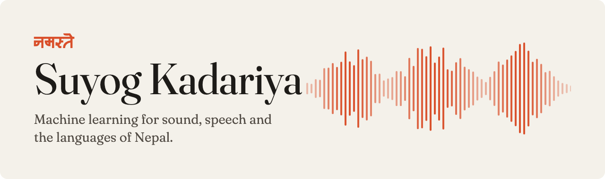
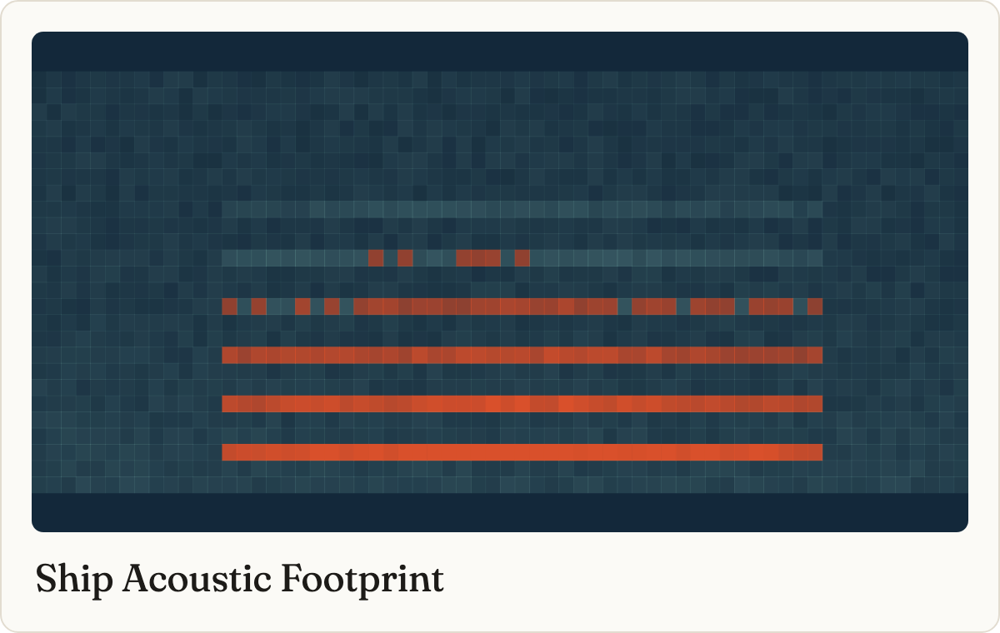
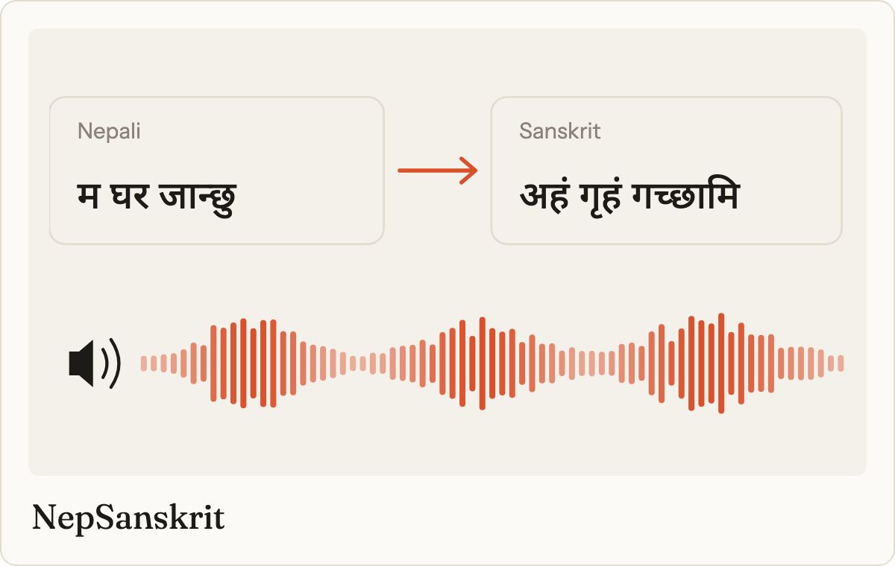
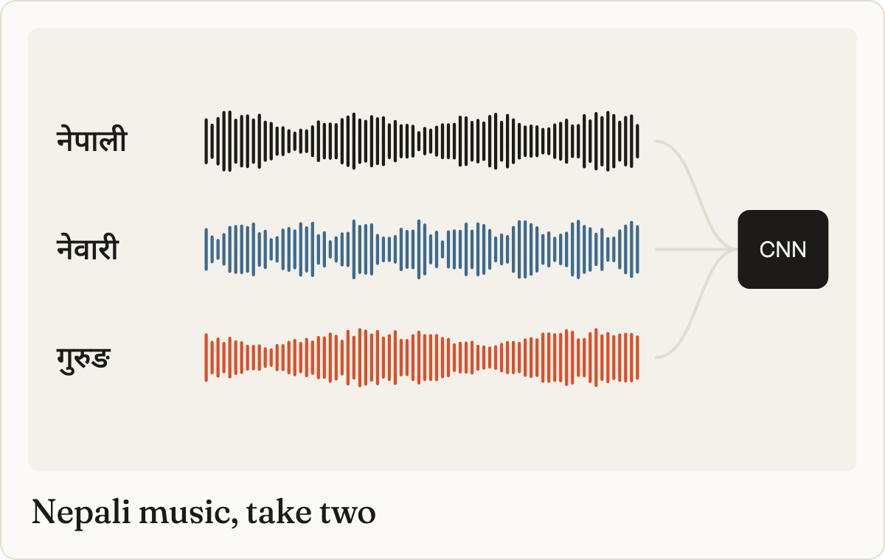
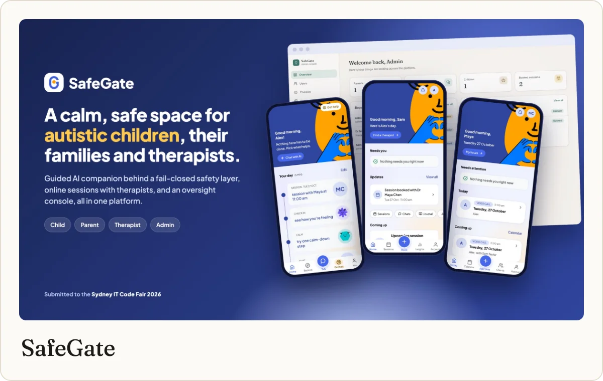
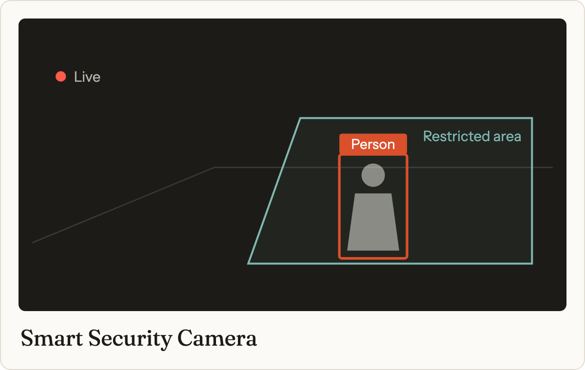
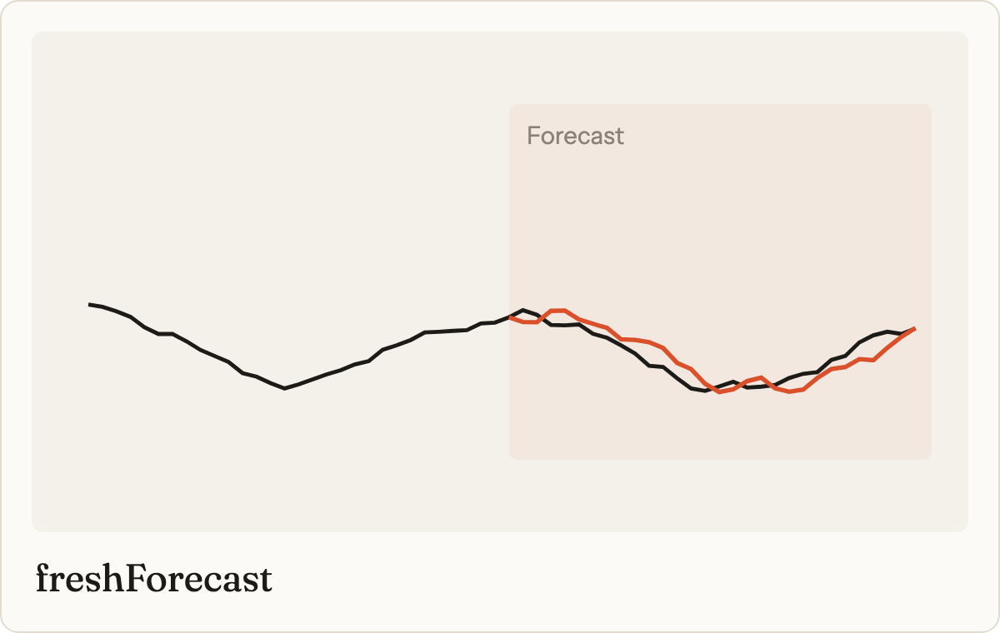
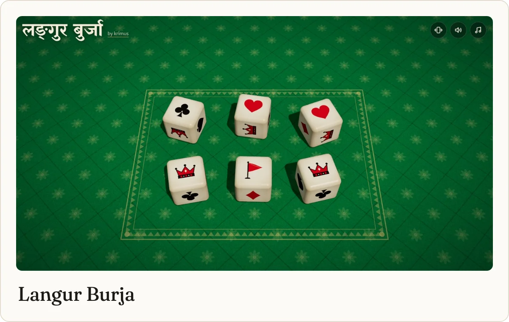
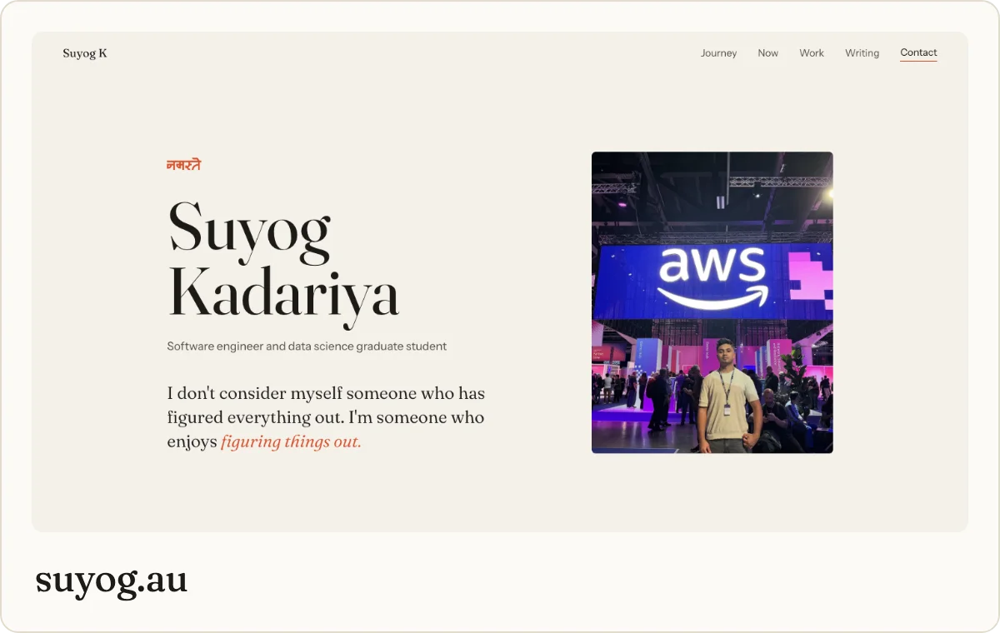

<a href="https://suyog.au">
  <picture>
    <source media="(prefers-color-scheme: dark)" srcset="assets/banner-dark.png">
    
  </picture>
</a>

Data science student at Charles Darwin University, software engineer by training, from Nepal, living in Sydney. Most of my repos start with a question I can't stop thinking about and a free weekend.

### Lately I've been listening to things

<table>
  <tr>
    <td width="33%" valign="top">
      
       Every vessel leaves a fingerprint in the water. I'm teaching models to read it.
    </td>
    <td width="33%" valign="top">
      
       Nepali text in, spoken Sanskrit out, with barely any data to learn from.
    </td>
    <td width="33%" valign="top">
      
       Rebuilding my honours project after finding a flaw in my own evaluation.
    </td>
  </tr>
</table>

### A few repos worth opening

<table>
  <tr>
    <td width="50%" valign="top">
      
       Support for autistic children and their families. The AI companion fails closed, and admins can't read messages.
    </td>
    <td width="50%" valign="top">
      
       YOLOv6 on a live CCTV feed, watching only the area you draw. Telegram ping when someone walks in.
    </td>
  </tr>
  <tr>
    <td width="50%" valign="top">
      
       Eight years of Kalimati market prices and an LSTM guessing what tomatoes will cost next week.
    </td>
    <td width="50%" valign="top">
      
       The dice game we play at home every Dashain, in 3D. The roll had to sound right.
    </td>
  </tr>
  <tr>
    <td width="50%" valign="top">
      
       Lorem ipsum in Nepali, because Devanagari designs deserve Devanagari placeholders. <a href="https://github.com/suyogkad/Nepali-Dummy-Text-Generator">Code</a>
    </td>
    <td width="50%" valign="top">
      
       Everything else, plus the writing, lives on <a href="https://suyog.au">suyog.au</a>.
    </td>
  </tr>
</table>

### Usually open on my laptop

### Say hello

Always happy to talk acoustics, low resource languages, or a strange dataset you've found.

